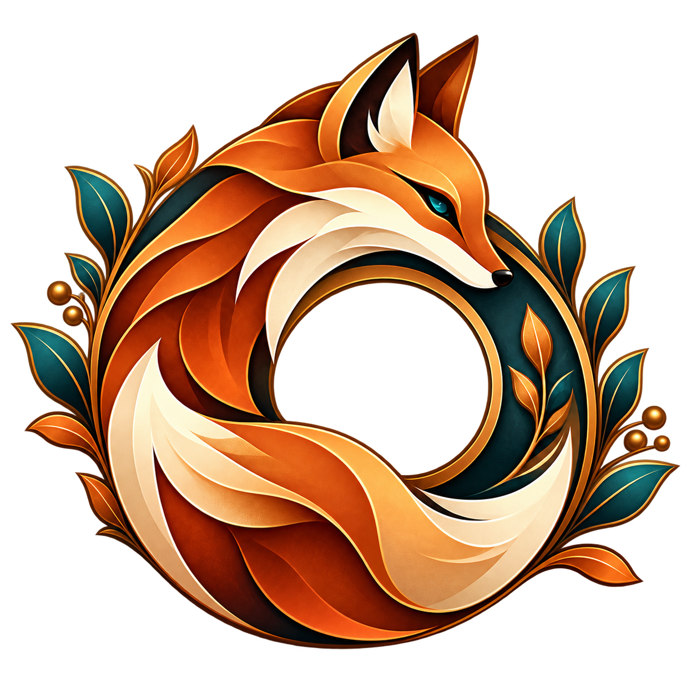
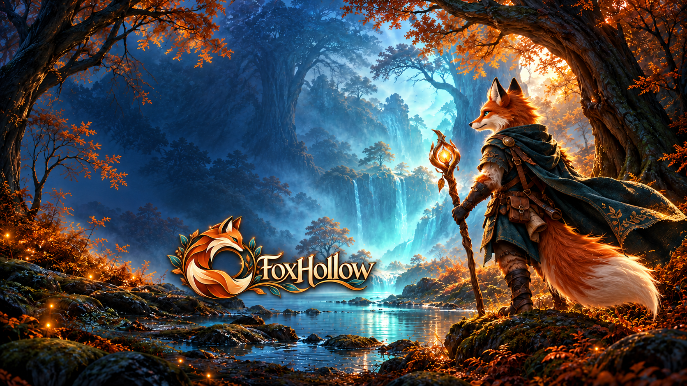

  

<h1 align="center">FoxHollow</h1>

<strong>A dedicated native PlayStation 5 port project for Star Fox Adventures.</strong>

Target firmware 12.40 | Bring your own GameCube disc image

## About

FoxHollow brings the native [Foxhollow](https://github.com/JackPriceBurns/foxhollow)
foundation to a dedicated PS5 homebrew project. That foundation is built on
[SFA-Decomp](https://github.com/zcanann/SFA-Decomp) and
[Aurora](https://github.com/encounter/aurora).

The PS5 integration is maintained here by **BaZZtian**. The original
decompilation, native PC port and renderer are the work of their respective
authors. This repository does not claim ownership of those projects.

The intended experience is a standalone native application using your own
game data, with PS5 graphics, audio, DualSense controls and isolated saves.
Those platform features are still being integrated and verified.

## Availability

**In development. No playable PS5 build or downloadable application release
is available yet.**

The current source includes the native read-only media adapter and its
GameCube filesystem and executable-boundary validation. This is groundwork
for the port, not an installable game. Successful component builds do not
establish console gameplay.

The Prospero Store identity is **PPSA99573**. The reservation is a Coming soon
placeholder; it is not a playable release or a download.

## Your game data

You must supply your own legally obtained copy of **Star Fox Adventures**.
The dedicated app is intended to read the game data locally from that image.
No game image, original executable, textures, music or saves are supplied.
Do not upload game files to this repository or attach them to issues.

| Disc profile | Disc ID | PS5 gameplay status |
| --- | --- | --- |
| Europe / PAL | `GSAP01` | Not verified |
| North America / NTSC-U | `GSAE01` | Not verified |

Recognizing a disc ID does not establish support for every revision. Both
regions require real gameplay verification before a downloadable release.

Background music must come from the user's own image through a local audio
pipeline. Original or converted music will not be included in public packages.
The menu artwork shown above is original project branding; the explorer
mascot is not a replacement character in the game.

## Credits

This project depends on the work of the following upstream communities:

| Project | Authors / maintainers | Contribution |
| --- | --- | --- |
| [SFA-Decomp](https://github.com/zcanann/SFA-Decomp) | zcanann and SFA-Decomp contributors | Star Fox Adventures decompilation forming the native foundation |
| [Foxhollow](https://github.com/JackPriceBurns/foxhollow) | JackPriceBurns and Foxhollow contributors | Native PC port used as the PS5 integration reference |
| [Aurora](https://github.com/encounter/aurora) | encounter and Aurora contributors | Graphics compatibility framework used by the native foundation |
| [ps5-payload-sdk](https://github.com/ps5-payload-dev/sdk) | Open PS5 payload SDK contributors | Open homebrew target toolchain |

The currently reviewed Foxhollow foundation is pinned to
`55371a2354ef36d4aabe53dfb78c19aa7f493737`. Its PC platform support and
upstream gameplay claims are not PS5 test results for this repository.

## Licensing and attribution

SFA-Decomp and Foxhollow publish CC0-1.0 declarations. Their notices and those
of separately licensed dependencies remain applicable. A root license does
not automatically cover every nested component or the original game data.

The existing [MIT license](LICENSE) applies to independently authored tooling
already distributed under that grant. It does not transfer ownership of the
original game or relicense upstream work. Each component's actual provenance
and distribution terms must be checked before inclusion in a release.

This is an unofficial homebrew project, not affiliated with, endorsed by or
sponsored by Nintendo or Rare. Original game content remains the property of
its respective rights holders.
